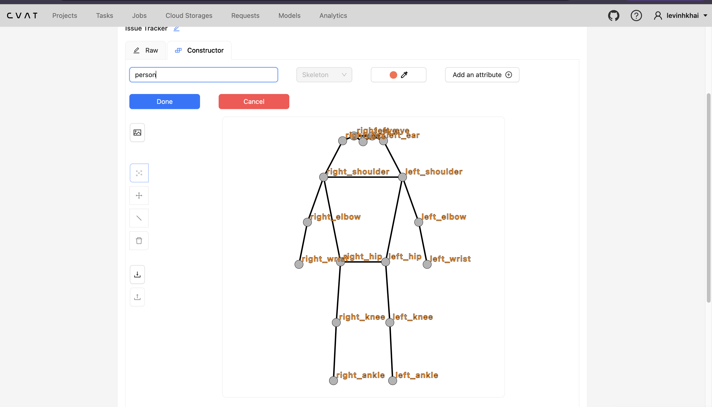
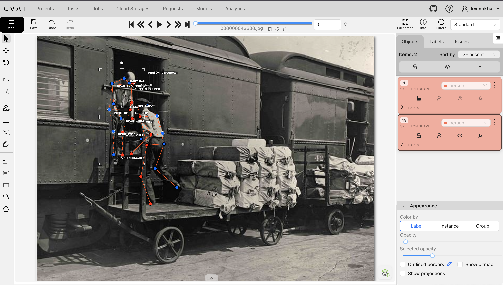
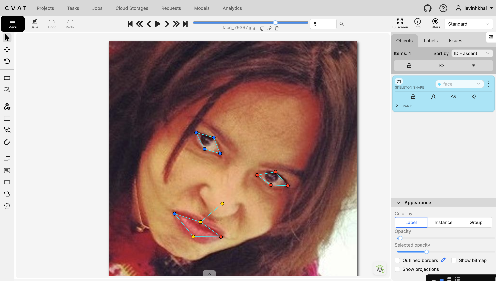
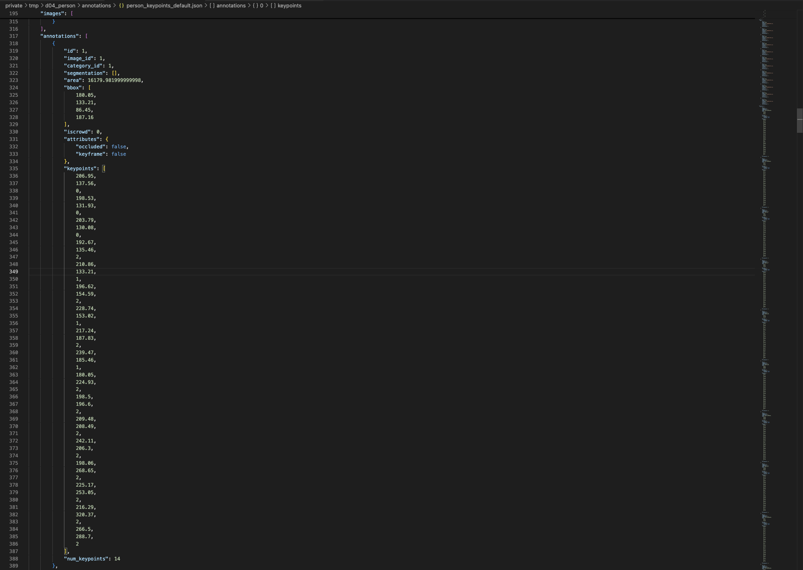

# Báo cáo cá nhân — LeVinhKhai-2A202603322

Đổi tên file theo quy tắc `MSSV_HoTen.md`. Ví dụ: `20241234_NguyenVanAn.md`.

Dữ liệu: 12 ảnh người COCO val2017 (Lin et al., 2014) và 8 ảnh chân dung Wikimedia Commons, chỉ dùng trong lớp.

## 0. Thông tin học viên

- Họ tên: Lê Vĩnh Khải
- MSSV: 2A202603322
- Email: 26ai.khailv@vinuni.edu.vn
- Link repository: https://github.com/LeVinhKhai/K5-L2B-DAY04-LeVinhKhai-2A202603322-KeypointPose
- Phiên bản CVAT (Help → About): 2.74.1
- Máy: hệ điều hành MacOS · RAM 16 GB · chạy CVAT chế độ đầy đủ / lite
- Bộ ảnh (`src/exports/assignment.json` do `lab.py setup` tạo): có 
- Giờ bắt đầu: 16:45, 12/11/2026
- Giờ kết thúc: 21:00, 12/11/2026

## 1. Kiểm tra label (CP0)

| Label | Kiểu | Số điểm | Tên điểm đúng bảng của lab? | Đúng thứ tự? | Số cạnh |
|---|---|---:|---|---|---:|
| `person` | Skeleton | 17 | Có | Có | 19 |
| `face` | Skeleton | 13 | Có | Có | 13 |

Mẫu `person` dựng theo người quay mặt về camera (các điểm `left_*` nằm bên phải khung mẫu)? Có 

Cách đổi cờ `occluded` / `outside` cho **một điểm** trên phiên bản CVAT này (một câu):
Rê chuột vào đúng keypoint rồi nhấn `Q` để đặt `occluded` (`v=1`) hoặc nhấn `O` để đặt `outside`
...

## 2. Số lượng đã gán và thời gian (CP1, CP2)

| Nhóm ảnh | Số ảnh | Số skeleton đã gán | Số người dưới 60 px (không gán) | Số poster / gương / màn hình bỏ qua | Thời gian (phút) |
|---|---:|---:|---:|---:|---:|
| `easy` | 5 | 5| - | - | 15 |
| `occluded` | 3 | 6 | - | - | 15 |
| `back` | 2 | 4 | - | - | 10 |
| `small` | 1 | 2 | 2 | 1 | 10 |
| `crowd` | 1 | 3 | 2 | - | 8 |
| `faces` | 8 | 8 | — | - | 20 |

- Số ảnh người đã xong ở mốc phút 105: 10 / 10
- Thời gian thực tế (phút): CP1 80 · CP2 20 · CP3 20
- Ảnh tốn thời gian nhất là ảnh nào, vì sao?
Ảnh tốn thời gian nhất là 000000309169.jpg vì trong ảnh có nhiều người với tư thế khác nhau, đồng thời một số keypoint bị che khuất hoặc không nhìn thấy rõ. Tôi phải kiểm tra kỹ từng skeleton, đặc biệt là các điểm ở mặt, vai, hông và chân, để quyết định điểm nào nên để visible, occluded (v=1) hay outside (v=0), tránh suy đoán sai vị trí
...

## 3. Bảng ca khó (CP1, CP2)

Mỗi điểm bạn phân vân một dòng, nhất là phân vân giữa `v = 1` và `v = 0`, hoặc không chắc hướng người.

| Ảnh | Người / mặt | Điểm | Cờ đã chọn | Phân vân giữa | Lý do chọn |
|---|---|---|---:|---|---|
| 000000183176.jpg | người 73 | right_hip, left_shoulder, right_shoulder, right_ear,right_eye,nose, right_elbow, right_wrist, left_ankle, right_ankle | v=0 | v=1 / v=0 | Phần lớn của người phía sau bị người phía trước và xe che gần như hoàn toàn, không đủ thông tin để ước lượng vị trí khớp một cách chắc chắn nên chọn outside (v=0) thay vì đoán. |
| 000000043500.jpg | người 19 | right_hip, right_knee | v=1 | v=1 / v=0 | Hai khớp bị che khuất một phần nhưng vẫn có thể suy ra vị trí dựa trên hướng thân, hông và chân của người nên chọn occluded (v=1) thay vì outside (v=0). | 
| 000000467300.jpg | người 307 | left_shoulder, left_hip | v=1 | v=1 / v=0 | Hai keypoint bị người phụ nữ phía trước che khuất, nhưng dựa vào hướng thân và tư thế của người đàn ông vẫn có thể ước lượng vị trí tương đối chắc chắn nên chọn occluded (v=1). |

## 4. Bảng tự review (CP3)

Đi từ ảnh cuối về ảnh đầu. 5 ảnh người (ít nhất 2 ảnh `back` hoặc `crowd`) và 3 ảnh mặt. Ít nhất 8 dòng, kể cả dòng `ok`. Ghi lỗi trước, sửa sau.

Mã lỗi dùng đúng một trong: `lr_swap`, `vis_flag`, `position`, `missing`, `extra`, `ok`.

| Ảnh | Người / mặt | Điểm | Mã lỗi | Ghi chú | Đã sửa? |
|---|---|---|---|---|---|
| 000000103970.jpg | người | - | ok | tự kiểm không thấy lỗi rõ ràng | không sửa |
| 000000261732.jpg | người | - | ok | tự review không thấy lỗi rõ ràng về left/right, vị trí keypoint hoặc visibility | không sửa |
| 000000309169.jpg | người | right_ear | vis_flag | đổi right_ear của person 199 sang occluded (v=1) vì tai bị che nhưng vẫn ước lượng chắc vị trí | có |
| 000000043500.jpg  | người | left_knee | vis_flag | đổi left_knee sang occluded (v=1) của person 1 vì khớp gối bị che nhưng vẫn ước lượng được vị trí | có |
| 000000467300.jpg | người | - | ok | tự review không thấy lỗi rõ ràng về left/right, vị trí keypoint hoặc visibility | không sửa |
| face_99874.jpg | mặt | - | ok | kính râm tối: 4 điểm mắt đã để occluded (v=1), không thấy lỗi rõ ràng về vị trí hoặc left/right | không sửa |
| face_79367.jpg | mặt | - | ok | tự review không thấy lỗi rõ ràng về left/right, vị trí keypoint hoặc visibility | không sửa |
| face_257657.jpg | mặt | - | ok | tự review không thấy lỗi rõ ràng về left/right, vị trí keypoint hoặc visibility | không sửa |
Tổng hợp số lỗi theo mã:

| `lr_swap` | `vis_flag` | `position` | `missing` | `extra` | `ok` |
|---:|---:|---:|---:|---:|---:|
| 0 | 2 | 0 | 0 | 0 | 6 |

Điểm còn phân vân giữa `v = 1` và `v = 0` (ghi cả hai lựa chọn và lý do chọn):
Ở ảnh 000000043500.jpg, tôi phân vân giữa v=1 và v=0 cho các điểm right_hip và right_knee của person 19 vì các khớp này bị che khuất. Tôi chọn v=1 vì dù không nhìn thấy trực tiếp, hướng thân và tư thế chân vẫn cho phép ước lượng vị trí khớp tương đối chắc chắn; chỉ chọn v=0 khi vị trí không thể suy ra đáng tin cậy.
...

## 5. Kiểm file xuất và kết quả tự kiểm (CP4)

Tự kiểm tay trong file JSON:

| File | Người / mặt kiểm (ảnh, thứ tự) | Số phần tử `keypoints` | Điểm `outside` ra `v = 0`, `occluded` ra `v = 1`? | `num_keypoints` khớp? |
|---|---|---:|---|---|
| `LeVinhKhai_persons.zip` | `000000043500.jpg`, annotation 1 | 51 | Có `v=0` và `v=1`, đúng mapping outside/occluded | Có (`14 = 14`) |
| `LeVinhKhai_persons.zip` | `000000043500.jpg`, annotation 2 | 51 | Có `v=1`, không có điểm `v=0` trong annotation này | Có (`17 = 17`) |
| `LeVinhKhai_faces.zip` | `face_105668.jpg`, annotation 1 | 39 | Không có `v=0` hay `v=1`; tất cả keypoint đều visible (`v=2`) | Có (`13 = 13`) |

Sau khi xuất, CVAT ghi `occluded` thành `v = 1` và `outside` thành `v = 0`. Tọa độ của điểm `outside` trong file là tọa độ cũ,  vì CVAT 2.x vẫn giữ lại cặp tọa độ trước đó của keypoint khi chuyển trạng thái sang outside; tuy nhiên điểm có v = 0 sẽ bị bỏ qua khi huấn luyện và khi chấm.

Hai job đã chuyển sang completed trên CVAT? Có 

Dán phần **TÓM TẮT** in ra từ `src/check_submission.py`:

```text
----- TÓM TẮT (dán vào báo cáo mục 5) -----
- File person: LeVinhKhai_persons.zip
  Số ảnh: 12 · số skeleton `person`: 20 · mỗi annotation 51 số
  Skeleton theo ảnh: 000000043500=2, 000000103970=1, 000000177889=1, 000000183176=2, 000000201702=1, 000000213933=1, 000000261732=1, 000000309169=3, 000000323705=2, 000000359340=2, 000000467300=2, 000000571665=2
  Cờ v: v=2 226 (66%) · v=1 67 (20%) · v=0 47 (14%)
  num_keypoints trung bình: 14.7
- File face: LeVinhKhai_faces.zip
  Số ảnh: 8 · số skeleton `face`: 8 · mỗi annotation 39 số
  Skeleton theo ảnh: face_105668=1, face_141135=1, face_257657=1, face_380639=1, face_380754=1, face_79367=1, face_79591=1, face_99874=1
  Cờ v: v=2 95 (91%) · v=1 9 (9%) · v=0 0 (0%)
  num_keypoints trung bình: 13.0
- Ghi chú: 47 điểm v = 0 vẫn mang tọa độ cũ (CVAT 2.x xuất như vậy; chuẩn COCO ghi 0, 0). Không phải lỗi: điểm v = 0 bị bỏ qua khi huấn luyện và khi chấm.
- Số [LỖI]: 0 · số [CẢNH BÁO]: 0
Kết quả: ĐẠT
```

Các `[CẢNH BÁO]` còn giữ nguyên và lý do: không có cảnh báo

...

## 6. Ảnh chụp màn hình

1. Label `person` trong label constructor (đủ 17 điểm có tên):

   

2. Một người quay lưng đã gán, cờ đã đặt:

   

3. Một khuôn mặt đã gán 13 điểm, phóng to vùng mắt:

   

4. Một đoạn JSON xuất của một người:

   

Nguồn ảnh: COCO val2017 / Wikimedia Commons.

## 7. Tự đánh giá

1. Lỗi bạn mắc nhiều nhất hôm nay, và cách bạn sẽ tránh ở dự án thật:

   Lỗi tôi hay gặp nhất hôm nay là phân biệt giữa keypoint occluded (v=1) và outside (v=0) trong các trường hợp bị che khuất hoặc không nhìn thấy rõ. Một số điểm như hông, gối, tai hoặc vai vẫn có thể ước lượng vị trí dựa trên tư thế cơ thể, nên tôi phải cân nhắc giữa v=1 và v=0. Trong dự án thực tế, tôi sẽ bám sát guideline, chỉ dùng v=1 khi vị trí khớp vẫn có thể suy ra tương đối chắc chắn từ cấu trúc cơ thể và dùng v=0 khi không đủ thông tin để xác định vị trí đáng tin cậy. Với các trường hợp không rõ ràng, tôi sẽ ghi lại để review thay vì tự suy đoán.

2. Một quy tắc bạn đề xuất thêm vào guideline (kèm ảnh ví dụ nếu có):

   Tôi đề xuất guideline bổ sung quy tắc rõ hơn cho các keypoint bị che khuất: nếu keypoint không nhìn thấy trực tiếp nhưng vị trí vẫn có thể suy ra tương đối chắc chắn từ các khớp lân cận và hướng cơ thể thì gán occluded (v=1); nếu vị trí chỉ có thể đoán mơ hồ hoặc không đủ thông tin thì gán outside (v=0). Guideline cũng nên có thêm ví dụ minh họa cho các trường hợp quay lưng, người bị che bởi người khác và các khớp ở phần thân dưới bị vật thể che khuất để giảm sự khác nhau giữa các annotator.

3. Nhãn của bạn đi vào model ở đâu? Chọn một lỗi bạn đã sửa và nói nó sẽ làm model học sai thế nào (heatmap, trọng số trong loss, hay bước lật ảnh):
   Các keypoint tôi gán sẽ trở thành tọa độ mục tiêu để model học heatmap cho từng khớp và tham gia trực tiếp vào quá trình tính loss. Ví dụ, tôi đã sửa left_knee của person 1 trong ảnh 000000043500.jpg sang trạng thái occluded (v=1) vì khớp gối bị che nhưng vị trí vẫn có thể ước lượng được. Nếu tôi đặt sai vị trí hoặc đặt cờ visibility không đúng, model có thể học heatmap tập trung vào vị trí sai hoặc tính loss trên một keypoint không đáng tin cậy, làm giảm độ chính xác dự đoán pose. Ngoài ra, việc gán sai left/right còn có thể gây lỗi khi áp dụng bước lật ảnh vì các cặp keypoint trái-phải cần được hoán đổi đúng.
   

## 8. Khó khăn và lỗi kỹ thuật

Không gặp lỗi kỹ thuật nghiêm trọng trong quá trình thực hiện.

## Bonus (nếu làm)

### B1 — 3 ảnh người khó thêm

| Ảnh | Số skeleton | Số người dưới 60 px | Ca khó nhất |
|---|---:|---:|---|
| 000000005294.jpg | 3 | 0 | Người bị tờ báo che phần lớn thân và tay; cần phân biệt điểm bị che nhưng còn ước lượng được (v=1) với điểm không thể xác định đáng tin cậy (v=0). |
| 000000161603.jpg | 4 | 0 | Ảnh bị mờ mạnh, đặc biệt vùng mặt và tay; cần tránh coi motion blur là occlusion. Điểm vẫn nhìn thấy được đặt v=2, còn điểm quá mờ không xác định được đặt v=0. |
| 000000188948.jpg | 3 | 0 | Có người bị che khuất và chuyển động tạo nhiều vệt tay; cần xác định cánh tay thật thay vì gán theo motion blur, đồng thời xử lý các điểm ngoài khung bằng v=0. |

Kết quả `src/check_submission.py` cho `HoVaTen_bonus_persons.zip`:

```text
----- TÓM TẮT  -----
- File person: LeVinhKhai_bonus_persons.zip
  Số ảnh: 3 · số skeleton `person`: 10 · mỗi annotation 51 số
  Skeleton theo ảnh: 000000005294=3, 000000161603=4, 000000188948=3
  Cờ v: v=2 87 (51%) · v=1 42 (25%) · v=0 41 (24%)
  num_keypoints trung bình: 12.9
- Ghi chú: 41 điểm v = 0 vẫn mang tọa độ cũ (CVAT 2.x xuất như vậy; chuẩn COCO ghi 0, 0). Không phải lỗi: điểm v = 0 bị bỏ qua khi huấn luyện và khi chấm.
- Số [LỖI]: 0 · số [CẢNH BÁO]: 5
Kết quả: ĐẠT (đọc lại từng cảnh báo ở trên)
  [CẢNH BÁO] 000000005294.jpg #2: cặp knee, ankle nằm ngược phía so với các cặp còn lại. Có thể đổi trái/phải một cặp (`lr_swap`), hoặc tay / chân bắt chéo thật: kiểm lại.
  [CẢNH BÁO] 000000005294.jpg #3: cặp ankle nằm ngược phía so với các cặp còn lại. Có thể đổi trái/phải một cặp (`lr_swap`), hoặc tay / chân bắt chéo thật: kiểm lại.
  [CẢNH BÁO] 000000161603.jpg #2: các điểm chỉ trải cao 54 px (< 60 px). Người dưới 60 px không gán; nếu người cao hơn nhưng bị cắt khung thì bỏ qua cảnh báo này.
  [CẢNH BÁO] 000000161603.jpg #3: các điểm chỉ trải cao 56 px (< 60 px). Người dưới 60 px không gán; nếu người cao hơn nhưng bị cắt khung thì bỏ qua cảnh báo này.
  [CẢNH BÁO] 000000188948.jpg #3: cặp wrist nằm ngược phía so với các cặp còn lại. Có thể đổi trái/phải một cặp (`lr_swap`), hoặc tay / chân bắt chéo thật: kiểm lại.
```

### B2 — 5 ảnh khuôn mặt đen trắng / hồng ngoại

Ảnh không màu khó hơn ở điểm nào? Kính râm trên ảnh hồng ngoại có còn là `v = 1` không?

Ảnh không màu khó hơn vì các đặc trưng trên khuôn mặt như khóe mắt, viền môi, sống mũi và vùng bị che có độ tương phản kém hơn ảnh màu, nên một số keypoint khó xác định chính xác hơn. Khi gán nhãn tôi phải dựa nhiều hơn vào hình dạng khuôn mặt, đối xứng hai bên và vị trí tương đối giữa các bộ phận thay vì màu sắc.

Kính râm trên ảnh hồng ngoại vẫn có thể gán v=1 nếu keypoint của mắt bị kính che nhưng vị trí vẫn có thể ước lượng đáng tin cậy từ hình dạng kính, khuôn mặt và các mốc lân cận. Nếu không thể xác định vị trí mắt một cách chắc chắn thì phải dùng v=0, không mặc định mọi điểm sau kính râm đều là v=1.

### B3 — Model so với nhãn của tôi (không tính điểm)
Không thực hiện
- Demo đã dùng:
- Ảnh đã thử:

1. Model có trả điểm cho khớp bị che, hay khớp ngoài ảnh không? Confidence ở các điểm đó thế nào?

   ...

2. Với người quay lưng, model có đổi trái/phải không?

   ...

3. Bộ điểm của model có giống 17 điểm COCO không?

   ...

## 9. Tài liệu tham khảo và công cụ AI đã dùng

ChatGPT- hỏi về một số định nghĩa và hỏi hướng dẫn làm bài theo github
